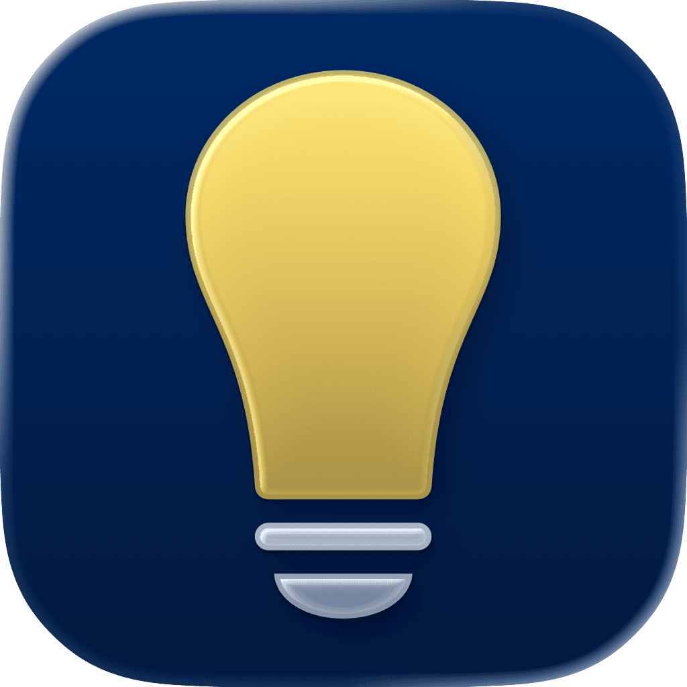

    

    
    
    
    

# OnboardingKit has moved...and changed!

After 10 versions, OnboardingKit has moved to a [new repository](https://github.com/kankoda/onboardingkit) and been converted to a closed-source project. The new SDK has more features with higher quality, so feel free to check it out.

This repository will remain as a public archive, but it will no longer be updated.

## Contact

Feel free to reach out if you have questions or if you want to contribute in any way:

* Website: [danielsaidi.com][Website]
* E-mail: [daniel.saidi@gmail.com][Email]
* Bluesky: [@danielsaidi@bsky.social][Bluesky]
* Mastodon: [@danielsaidi@mastodon.social][Mastodon]

[Email]: mailto:daniel.saidi@gmail.com
[Website]: https://www.danielsaidi.com
[GitHub]: https://www.github.com/danielsaidi
[OpenSource]: https://danielsaidi.com/opensource
[Sponsors]: https://github.com/sponsors/danielsaidi

[Bluesky]: https://bsky.app/profile/danielsaidi.bsky.social
[Mastodon]: https://mastodon.social/@danielsaidi
[Twitter]: https://twitter.com/danielsaidi

[Documentation]: https://danielsaidi.github.io/OnboardingKit
[Getting-Started]: https://danielsaidi.github.io/OnboardingKit/documentation/onboardingkit/getting-started
[License]: https://github.com/danielsaidi/OnboardingKit/blob/master/LICENSE
